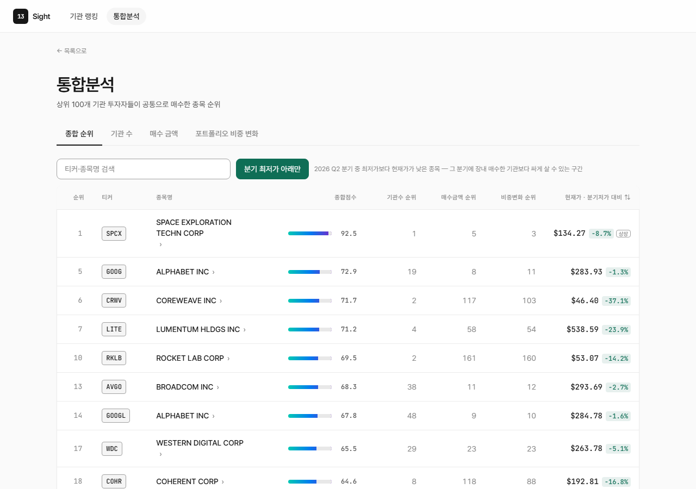
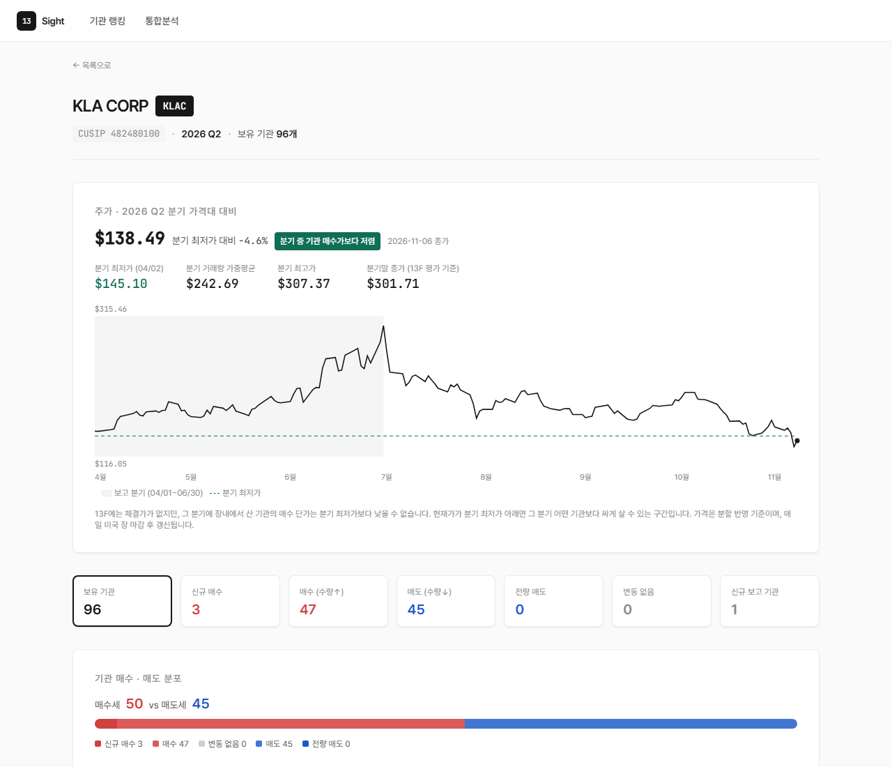

# 13Sight — 미국 기관투자자 13F 추적

미국 SEC에 공시되는 **13F 보고서**(운용자산 1억 달러 이상 기관의 분기말 보유 종목)를 모아, **운용금액 상위 100개 기관이 이번 분기에 공통으로 사들인 종목**을 순위로 보여 주는 웹 서비스입니다.
주가를 함께 붙여 **"그 분기 최저가보다 지금이 더 싼 종목"**, 즉 그 분기에 장내에서 산 어떤 기관보다 싸게 살 수 있는 종목을 골라 볼 수 있습니다.

🌐 **http://161.33.143.61:5001**



- **현재 데이터: 2026 Q2** (6/30 기준). 매년 2/20·5/20·8/20·11/20에 다음 분기가 자동으로 수집됩니다.
- **개인 참고용입니다.** 투자 권유가 아니며, 13F는 분기말 스냅샷이라 공시 시점에 이미 최대 45일, 보는 시점에는 몇 달이 지난 정보입니다.

## 할 수 있는 것

| 페이지 | 주소 | 내용 |
|---|---|---|
| 기관 랭킹 | `/` | 운용금액 상위 100개 기관(한국어 이름 병기), 기관·종목 검색 |
| 기관 분석 | `/institution/<cik>` | 한 기관의 보유 종목을 전체·매수·매도·신규 매수·전량 매도로 나눠 직전 분기와 비교, 포트폴리오 트리맵 |
| 종목 분석 | `/stock/<cusip>` | 이 종목을 가진 기관 목록과 매수·매도 분포, 통합분석 점수, **분기 가격대 대비 현재가와 주가 차트** |
| 통합분석 | `/consensus` | 공통 매수 종목 순위(종합·기관 수·매수 금액·비중 변화). **"분기 최저가 아래만" 필터**와 **분기 저가 대비 정렬** |



## 어떻게 동작하나

```
[SEC EDGAR 13F] ─▶ collect_institutions ─▶ collect_holdings ─▶ build_consensus ─▶ 웹(v2/app.py)
                    전체 기관 운용금액        상위 100개 기관의        공통 매수 종목
                    → 상위 100개 선정          2개 분기 보유 종목        점수·순위
                                              + 기업 액션 보정
[Polygon 일봉]   ─▶ collect_prices (매일) ─▶ 분기 최저가·VWAP·최고가 대비 현재가
```

- **분기 수집**: 스케줄러가 제출 마감(분기말+45일) 뒤 2/20·5/20·8/20·11/20 자정에 위 3단계를 순서대로 실행합니다. 앞 단계가 실패하면 멈추고, 수집이 0건이면 기존 데이터를 지우지 않습니다.
- **주가 갱신**: 매일 미국 장 마감 후(한국 08:30) 전 종목 일봉을 받아 분기 가격대를 다시 계산합니다. 분할 전 가격은 현재 기준으로 환산합니다.

### 추천 순위 계산

직전 분기보다 **보유 주식 수가 늘어난 기관만 '매수'** 로 보고 세 지표를 계산합니다.

| 지표 | 의미 | 가중치 |
|---|---|---|
| 기관 수 | 이 종목을 매수한 기관이 몇 곳인가 | 50% |
| 매수 금액 | 새로 산 주식의 분기말 평가금액 합 | 30% |
| 비중 변화 | 새로 산 주식이 각 기관 운용금액에서 차지하는 비중의 합 (기관 규모와 무관한 확신도) | 20% |

각 지표는 순위를 로그 척도로 0~100점으로 바꾼 뒤 가중 합산합니다.

### 데이터 보정

13F를 그대로 비교하면 실제 매수가 아닌 것이 매수로 잡혀 순위가 왜곡됩니다. 그래서 수집 후 자동으로 보정합니다.

- **주식 분할·병합**: 분할하면 모든 기관의 주식 수가 같은 배수로 늘어 '전원 매수'처럼 보입니다 → 분할을 감지해 직전 분기 수량을 환산 (예: KLAC 10:1, BKNG 25:1)
- **CUSIP 재발급**: 같은 회사가 새 종목코드를 받으면 '전량 매도 + 신규 매수'처럼 보입니다 → 같은 발행사 코드끼리 자동 통합
- **분사·합병·미국 상장 이전**: 받은 주식과 산 주식을 13F만으로는 구분할 수 없어, 해당 분기에만 순위에서 제외합니다(수동 등록). 신규 상장(IPO)은 실제 매수라 그대로 반영합니다.

자세한 판정 기준과 사례는 [issues.md](issues.md) 7·8번에 있습니다.

## 문서

| 문서 | 언제 읽나 |
|---|---|
| [CLAUDE.md](CLAUDE.md) | **전체 구조를 한 번에 볼 때.** 실행 명령, 파일 역할, DB 스키마, 집계 로직, 규칙. Claude Code가 매 세션 읽는 작업 규칙이기도 합니다 |
| [issues.md](issues.md) | 알려진 데이터 문제와 조치 기록 (T. Rowe Price 단위 오류, 미래에셋 오신고, CUSIP 변종, 기업 액션 등) |
| [ideas.md](ideas.md) | 앞으로 만들 기능과 우선순위 (순위 이력, 백테스트, LLM 기업 액션 분류, Discord 알림, 뉴스) |
| [deploy/DEPLOY.md](deploy/DEPLOY.md) | Oracle Cloud VM에 처음 올리는 법과 문제 대응 |

## 폴더 구조

```
13Sight\
├─ README.md                  이 설명서
├─ CLAUDE.md                  전체 구조·규칙 (Claude Code 작업 규칙 겸용)
├─ issues.md · ideas.md       알려진 문제 / 아이디어·로드맵
│
├─ collect_institutions.py    ① 분기 전체 13F 기관 운용금액 수집 → 상위 100개 선정 (+ 기관명 번역)
├─ collect_holdings.py        ② 상위 100개 기관의 2개 분기 보유 종목 수집 + 기업 액션 보정
├─ build_consensus.py         ③ 공통 매수 종목 점수·순위 계산
├─ collect_prices.py          ④ 주가 일봉·분할 이력 수집 → 분기 가격대 대비 현재가
├─ translate_institutions.py  기관명 한국어 번역 (Gemini)
├─ scheduler.py               분기 수집·매일 주가 갱신 자동 실행 (APScheduler)
├─ utils.py                   DB 설정, SEC 세션, CUSIP 별칭·제외 목록
├─ institution_names_kr.json  기관명 번역 캐시 (운영 서버 파일이 기준)
│
├─ v2\                        ★ 웹 (Flask). app.py + templates\
├─ app.py · templates\        구버전 웹(v1). 동결, 쓰지 않음
│
├─ deploy\                    VM 배포: 런북, systemd 서비스, 원클릭 재배포 스크립트
├─ test\                      2025 Q1 기준 백테스트 스크립트와 결과
└─ docs\                      README용 화면 캡처
```

## 실행 (로컬)

PostgreSQL과 Python이 필요합니다.

```bash
pip install -r requirements.txt
```

프로젝트 폴더에 `.env`를 만듭니다 (`.env`는 git에 올리지 않습니다).

```
DB_HOST=localhost
DB_PORT=5432
DB_NAME=postgres
DB_USER=postgres
DB_PASSWORD=

OPENFIGI_API_KEY=    # 종목코드 → 티커 변환. 없어도 되지만 매우 느림
GEMINI_API_KEY=      # 기관명 한국어 번역. 없으면 번역만 건너뜀
POLYGON_API_KEY=     # 주가. 무료 키로 충분 (massive.com)
```

데이터를 처음부터 쌓을 때는 이 순서로 실행합니다. 테이블은 스크립트가 만듭니다.

```bash
python collect_institutions.py 2026 2   # 1. 전체 기관 수집 (약 1시간)
python collect_holdings.py              # 2. 보유 종목 수집 (OpenFIGI 키 있으면 약 30분)
python build_consensus.py               # 3. 순위 계산 (1분)
python collect_prices.py                # 4. 주가 (처음에는 분기 시작일부터 백필, 무료 요금제로 약 30분)
python v2/app.py                        # 웹 → http://localhost:5001
```

운영 서버 DB를 덤프해 복원하면 1~4단계 없이 바로 웹을 띄울 수 있습니다 (방법은 [deploy/DEPLOY.md](deploy/DEPLOY.md) 7단계 참고).

## 배포

**Oracle Cloud Always Free VM 한 대**에서 웹(gunicorn)·스케줄러·PostgreSQL을 함께 돌립니다.
코드를 고친 뒤 프로젝트 폴더에서 아래 한 줄이면 서버에 반영되고 웹이 재시작됩니다.

```bash
bash deploy/redeploy.sh              # 스케줄러 코드도 바꿨으면 --scheduler
```

`.env`·DB·번역 캐시는 덮어쓰지 않습니다. 처음 서버를 만드는 법은 [deploy/DEPLOY.md](deploy/DEPLOY.md).

## 기술 스택

- **백엔드**: Python, Flask, PostgreSQL(psycopg2), APScheduler, gunicorn
- **프론트**: Jinja 템플릿 + 순수 CSS/JS. 트리맵과 주가 차트는 서버에서 SVG로 직접 그립니다 (차트 라이브러리 없음)
- **인프라**: Oracle Cloud VM (Ubuntu 22.04), systemd

## 데이터 출처

- 13F 보고서: [SEC EDGAR](https://www.sec.gov/edgar)
- 종목코드(CUSIP) → 티커: [OpenFIGI](https://www.openfigi.com/)
- 주가 일봉·분할 이력: [Polygon.io (Massive)](https://massive.com/)
- 기관명 번역: Google Gemini

## 알아 둘 것

- **투자 조언이 아닙니다.** 13F는 롱 포지션만 담고(공매도·현금·해외 상장 주식 제외), 체결 시점과 단가가 없습니다. 분기 중간에 샀다가 판 거래는 보이지 않습니다.
- "분기 최저가보다 현재가가 낮다"는 **장내 매수 기준**입니다. 공모가로 배정받은 신규 상장 종목(화면에 `상장` 표시)이나 할인 발행으로 받은 기관은 장내 최저가보다 싸게 샀을 수 있습니다.
- API 키와 DB 비밀번호는 `.env`에만 있고 이 저장소에는 없습니다.
- 코드 라이선스는 정하지 않았습니다.
